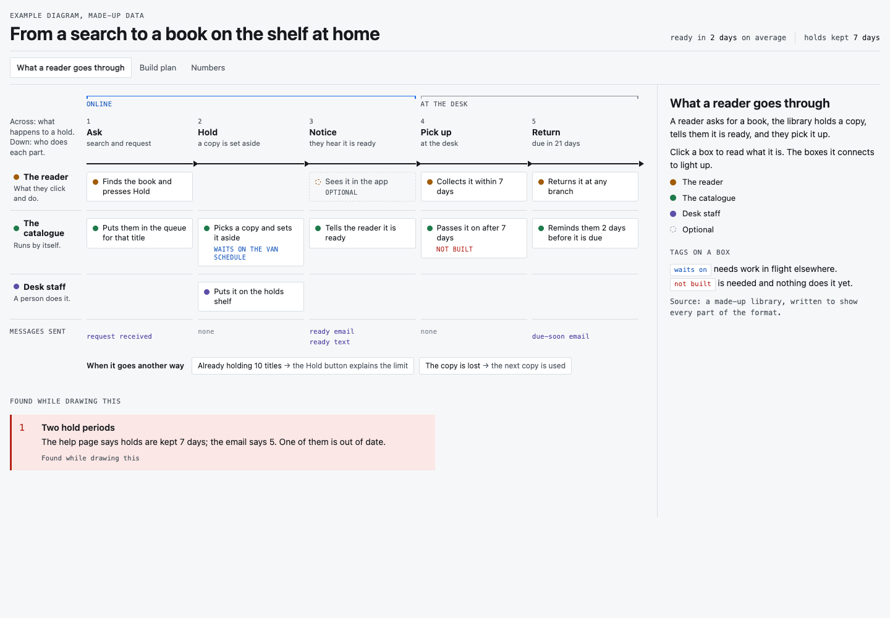

# system-diagram

A Claude Code skill that turns a spec, plan, PRD, design doc or a running system into one
interactive diagram page. The page is a grid: the steps go across, and who does each part goes
down. Click any box to open a side panel with a plain sentence first and the technical detail
after. Extra tabs can hold a build plan, tables, numbers and open questions.

Claude writes one data file. A fixed script builds the page from it, and a checker clicks
everything on the page and takes screenshots. The result is a single HTML file that works in any
browser, with dark mode and a phone layout. Where your Claude has an Artifact tool, the page is
published as an Artifact; otherwise you get the HTML file.



## Install

You need `python3`. The checker also needs Node 18 or newer, with npm. Nothing else: no fonts,
no design system, no account. Building a page needs no network.

1. Clone this repo into your Claude Code skills folder:

   ```bash
   git clone https://github.com/amdahlco/system-diagram.git ~/.claude/skills/system-diagram
   ```

   Windows (PowerShell):

   ```powershell
   git clone https://github.com/amdahlco/system-diagram.git $HOME\.claude\skills\system-diagram
   ```

   If that folder already exists, move it away first.

2. Set up the checker. Do this once per machine.

   macOS and Linux:

   ```bash
   mkdir -p ~/.cache/system-diagram-check && cd ~/.cache/system-diagram-check && npm init -y && npm i playwright-core@1.48.2 && npx playwright-core install chromium
   ```

   This downloads Chromium (about 150 MB) once. On Linux, use
   `npx playwright-core install --with-deps chromium` for the last part; it asks for sudo to
   install system libraries.

   Windows (PowerShell):

   ```powershell
   mkdir ~\.cache\system-diagram-check; cd ~\.cache\system-diagram-check; npm init -y; npm i playwright-core@1.48.2; npx playwright-core install chromium
   ```

   No Node? The skill still builds pages; Claude then asks you to open the page and click
   through it instead of running the checker.

3. Start a new Claude Code session. The skill loads when you ask for it.

To get updates later: `git -C ~/.claude/skills/system-diagram pull`.

## Check that it works

```bash
cd ~/.claude/skills/system-diagram
python3 build.py examples/skeleton/data.json --out /tmp/x.html
node tools/check.mjs /tmp/x.html /tmp/check
```

Windows (PowerShell):

```powershell
cd $HOME\.claude\skills\system-diagram
py build.py examples\skeleton\data.json --out $env:TEMP\x.html
node tools\check.mjs $env:TEMP\x.html $env:TEMP\check
```

The build prints `0 warnings`. The checker prints `0 script errors, 0 empty panels, 0 could not be
clicked, 0 dead tabs, 0 overflow` and saves screenshots in `/tmp/check`. It may also print an
`info:` line saying the grid scrolls sideways on a phone; that is by design. To open the page in a
browser yourself, add `--standalone` to the build command.

## Use it

Ask Claude Code something like "turn this spec into a visual diagram" or "map this flow", and
give it the file, the link or the pasted text. Claude follows `SKILL.md`: it reads the whole
source, writes the data file, builds and checks the page, checks every sentence against the
source, and gives you the page (as an Artifact where that is available, otherwise as an HTML
file).

## Your own look

The page uses one theme, `themes/neutral.json`, which relies on each reader's system fonts so it
looks right everywhere. For a brand look, copy that file, change the colors, and build with
`--theme path/to/your-theme.json`. Brand fonts are optional: put the font files next to your
theme, list them in `fontFiles`, and the build inlines them into the page. If a font file is
missing, the build warns and falls back to system fonts; it never stops. Only inline fonts whose
licence allows it. The theme format is in `references/schema.md`.

## What is in this repo

- `SKILL.md`: the steps and rules Claude follows.
- `build.py`: checks the data file and builds the page.
- `engine/`: the page shell and its script.
- `themes/neutral.json`: the default theme.
- `tools/check.mjs`: the checker.
- `references/schema.md`: every field of the data file, and the theme format.
- `references/judge.md`: the prompt for an independent check of a diagram against its source.
- `examples/skeleton/`: a short made-up example that uses every feature. Start from this one.

## Contributing

Issues and pull requests are welcome. See `CONTRIBUTING.md`. To report a security problem, see
`SECURITY.md`.

## Licence

MIT. See `LICENSE`.
